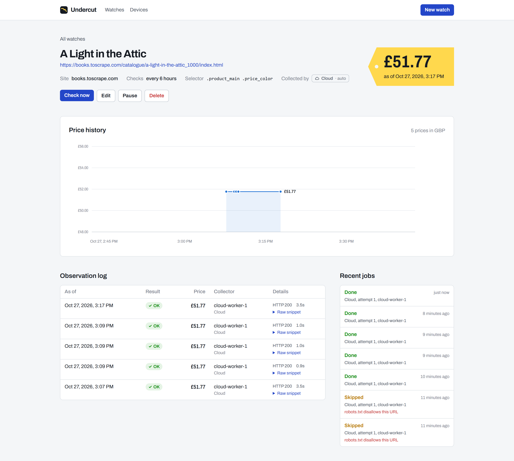
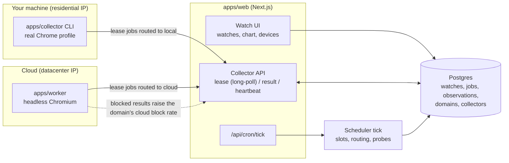
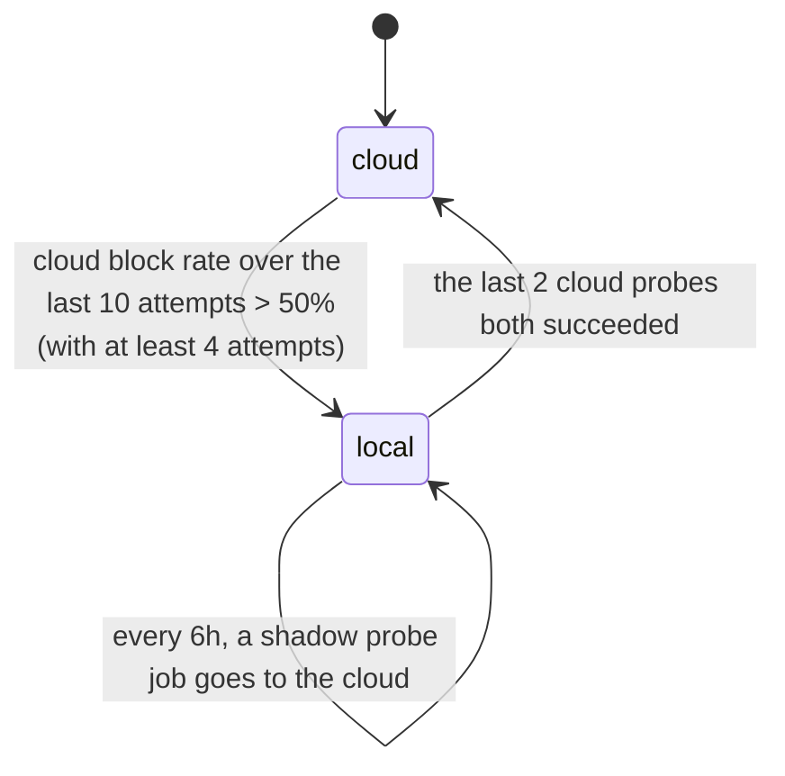

# Undercut

> Track the price of anything on any site, including the ones that block bots.



## Why this exists

Undercut started as a personal tracker for Cancun resort prices. The first version was a cloud job
that scraped Expedia and Booking.com every two hours, and it hit a wall: travel sites bot-block
datacenter IPs. From the cloud, every request came back as a 403, a "Just a moment..." challenge,
or a page shell where the price never rendered. The only thing that reliably got prices was a real
browser on a home internet connection.

The fix was a hybrid design, and Undercut turns it into a product:

- **Cloud workers** collect from sites that allow it. They are cheap, fast, and always on.
- A **local collector** (a small CLI on your own machine) runs a real Chromium on your residential
  IP for the sites that block the cloud. It pulls jobs from the server and pushes results back.
- The **scheduler learns the routing**. Each domain starts on the cloud. When the cloud's block
  rate on a domain crosses a threshold, the domain moves to local collectors, and the cloud is
  re-probed periodically in case the block lifts. Nobody has to configure which sites block bots.

## Status

| Milestone | Scope | State |
| --- | --- | --- |
| M1 | Data model, watch CRUD, cloud collector, price history | Done |
| M2 | Local collector, job leasing, device auth | Done |
| M3 | LLM-assisted selector extraction and self-healing | Interface in place (`Extractor`) |
| M4 | Alert engine and channels | Hook in place (`ObservationHook`, `AlertEvaluator`, `shouldRealert`) |
| M5 | Learned routing dashboard | Routing is live; the Devices page shows per-domain block rates |
| M6 | Deploy, showcase migration, write-up | Not started |

## Architecture



Both collectors speak the same HTTP protocol (`packages/core/src/protocol.ts`, zod-validated on
both ends) and share one runtime (`packages/collector-runtime`). The only difference between a
cloud worker and a local collector is which jobs the server routes to it.

### Packages

| Path | What it is |
| --- | --- |
| `packages/core` | Pure domain logic: types, price parsing, block classification, routing policy, anti-flap helpers, extractor and alert interfaces, wire protocol. No I/O. |
| `packages/db` | SQL migrations and a typed query layer over postgres.js: watches, collectors, leasing, results, scheduler, read models. |
| `packages/collector-runtime` | What every collector runs: API client, Playwright capture, robots.txt cache, the lease loop. |
| `apps/web` | Next.js App Router: the UI plus the collector API and the cron entry point. |
| `apps/worker` | Cloud collector process (headless Chromium, JSON logs). |
| `apps/collector` | Local collector CLI: `login`, `run`, `status`, `logout`. |

I chose plain SQL migrations plus a thin typed query layer over an ORM because the interesting
parts of this system are SQL: `FOR UPDATE SKIP LOCKED`, partial unique indexes, and data-modifying
CTEs. They read best as SQL.

## Job leasing

Jobs live in a Postgres table, not a separate queue. The table gives the leasing guarantees in a
few statements, and the database the app already needs is the only infrastructure.

**Lease.** One statement picks and claims a job (`packages/db/src/jobs.ts`, `leaseJob`):

```sql
WITH candidate AS (
  SELECT j.id FROM jobs j JOIN domains d ON d.domain = j.domain
  WHERE j.route = $kind AND j.attempts < j.max_attempts AND j.not_before <= now()
    AND (j.status = 'queued' OR (j.status = 'leased' AND j.lease_expires_at < now()))
    AND <domain politeness budget available>
  ORDER BY j.scheduled_for
  LIMIT 1
  FOR UPDATE OF j, d SKIP LOCKED
), leased AS (
  UPDATE jobs SET status = 'leased', lease_id = gen_random_uuid(), leased_by = $collector,
         lease_expires_at = now() + $ttl, attempts = attempts + 1
  FROM candidate WHERE jobs.id = candidate.id RETURNING jobs.*
), dispatched AS (
  UPDATE domains SET last_dispatched_at = now() FROM leased WHERE domains.domain = leased.domain
)
SELECT ... FROM leased JOIN watches ...;
```

- **`SKIP LOCKED`.** Competing collectors skip rows another transaction holds instead of waiting
  on them. Each job goes to exactly one collector, with no lock convoy.
- **Locking the domain row too** (`OF j, d`) serializes lease decisions per domain. Two collectors
  can't both see "one slot left" for the same site, so the per-domain concurrency limit holds
  under a race.
- **Expired leases are just leasable.** A crashed collector's job becomes available again when its
  lease runs out, with no reaper process. `attempts` counts tries, and the scheduler tick fails
  jobs that expire on their last attempt.
- **Fencing token.** Every lease gets a fresh `lease_id`, and a result is accepted only with the
  current one. A slow collector that comes back after its job was re-leased gets `409 lease_lost`
  and discards its result.
- **Leases are extended by heartbeat.** Collectors heartbeat every 30s with the lease ids they are
  still working on, so a slow page doesn't look like a dead collector.
- **Long-poll.** `POST /api/collector/lease` holds the request open for up to 30s until a job
  appears, so local collectors get work promptly without hammering the server.

**At-least-once collection, exactly-once recording.** A job may be attempted more than once. It is
recorded once at most:

| Failure | What prevents a duplicate |
| --- | --- |
| Scheduler tick retried or run twice | `idempotency_key = variant:slot` is `UNIQUE`; inserts use `ON CONFLICT DO NOTHING` |
| Collector offline, slots keep passing | Partial unique index: at most one outstanding job per variant, so no backlog |
| Collector dies mid-job | Lease expires; another collector re-leases it (`attempts` + 1) |
| Old lease holder reports late | `lease_id` fencing → `409` |
| HTTP response to a result is lost; collector retries | Job is already `done` with that lease → replay returns the original observation id |
| Any bug in the above | `observations.job_id` is `UNIQUE` |

Alert hooks (M4) run **after** the result transaction commits, so a failing notification can never
roll back or duplicate collected data.

## Learned routing policy

The policy is a pure function in `packages/core/src/routing/policy.ts`. The database applies it
inside the result transaction (`reevaluateRoute`), so every observation is fresh evidence.



- **Start on cloud.** It's the cheap path, and most sites allow it.
- **Move to local on sustained evidence.** The block rate is computed over a sliding window of the
  domain's last N cloud attempts, with a minimum sample count, so one bad request doesn't move a
  domain. Parse errors don't count as blocks: the page loaded, and the selector is the problem.
- **Re-probe the cloud.** While a domain is on local, the scheduler sends a *shadow* probe job to
  the cloud every 6 hours, in addition to the normal local job. Probing never costs the user a
  data point.
- **Hysteresis.** Entering local needs a sustained block rate. Leaving needs consecutive clean
  probes. The asymmetry stops a domain from flapping between routes on one lucky request. It's the
  same idea as the re-alert hysteresis below.
- **Overrides.** A watch can pin `cloud` or `local`. `auto` (the default) follows the domain.
- When a domain switches, queued (not yet leased) jobs are re-routed on the next tick.

All thresholds live in `DEFAULT_ROUTING`. The Devices page shows each domain's route, the reason it
switched, and recent and lifetime block rates per collector kind.

### What counts as "blocked"

`classifyCapture` (`packages/core/src/capture/classify.ts`) checks in this order:

1. A parsed price on a 2xx page is `ok`, even if a captcha widget is embedded somewhere on it.
2. HTTP 401/403/407/429 is `blocked`.
3. A challenge-page fingerprint is `blocked`, even when served with 200. Covered: Cloudflare,
   Akamai, PerimeterX, DataDome, Imperva, AWS WAF, reCAPTCHA, hCaptcha, and generic bot walls. Only
   challenge markers are listed, not vendors' always-on sensor scripts.
4. An empty price element, or a near-empty app shell, is `blocked`. Defenses often serve a 200
   page that never renders the price.
5. A full page where the selector matches nothing is a `parse_error`. That points at the selector
   (M3 self-heals these), not at the site.
6. A plain 5xx is transient: the job is retried with exponential backoff and nothing is recorded.

## Politeness

- **Per-domain concurrency** (`domains.max_concurrency`, default 1) and **minimum spacing**
  (`domains.min_interval_ms`, default 5s). Both are enforced in the lease statement, so they hold
  across any number of collectors.
- **robots.txt** is on by default. Collectors check it before fetching, as user agent
  `UndercutBot`, with a per-origin cache. A 4xx means no robots.txt (allow). A 5xx or an
  unreachable file means permission is unknown, so nothing is fetched and the job is retried with
  backoff. (The first live run hit exactly this: a transient timeout fetching robots.txt.) A
  disallowed job is marked `skipped`, not retried. Each domain can opt out (`domains.respect_robots`), and so can the local
  CLI (`--ignore-robots`).

## Device auth

Collectors authenticate with bearer tokens shaped like `uc_local_<43 chars>` (256 random bits).
Only a SHA-256 hash is stored (`collectors.token_hash`, unique-indexed), plus the last 4 characters
for display. A fast hash is the right choice here, unlike for passwords: a 256-bit random secret
can't be brute-forced, and a slow hash would only slow down every API call. The token is shown once
at creation. Revoking a device takes effect on its next request.

## Extension points (M3 and M4)

- **`Extractor`** (`packages/core/src/extract/types.ts`) turns a rendered `PageSnapshot` into a
  price. M1 ships `SelectorExtractor`. The M3 LLM-assisted extractor implements the same async
  interface, and `ExtractionRule` is a discriminated union that gains an `llm` variant, so
  collectors don't change.
- **`ObservationHook`** (`packages/core/src/alerts/hooks.ts`) receives every committed
  observation. M4 registers the alert engine in `apps/web/lib/hooks.ts`. `AlertRule` and
  `AlertEvaluator` define the rules (below target, drop by X%, new all-time low). `shouldRealert`
  (the original tracker's "$25 step" rule) and `confirmedPrice` (debounce) in
  `packages/core/src/hysteresis` are ready for it.

## Running locally

Requires Node 22+, pnpm 10+, and Docker.

```bash
pnpm install
pnpm exec playwright install chromium     # browser for collectors and tests
cp .env.example .env                      # one .env at the root serves every app

pnpm db:up                                # Postgres 17 on localhost:5447 (UNDERCUT_DB_PORT to change)
pnpm db:migrate

# A token for the cloud worker; put it in .env as UNDERCUT_COLLECTOR_TOKEN
pnpm admin create-collector --kind cloud --name cloud-worker-1

pnpm dev        # web on http://localhost:3210 + scheduler loop + cloud worker
```

Add a watch in the UI. For example, use
`https://books.toscrape.com/catalogue/a-light-in-the-attic_1000/index.html` with selector
`.product_main .price_color`. The first check is queued immediately.

**Local collector.** On the Devices page, create a local device token, then:

```bash
pnpm --filter @undercut/collector build
node apps/collector/dist/cli.js login --server http://localhost:3210 --token uc_local_...
node apps/collector/dist/cli.js run --headed      # uses your installed Chrome if available
```

**End-to-end smoke run** (live, against books.toscrape.com, a site built for scraping practice):

```bash
pnpm --filter @undercut/web build && pnpm --filter @undercut/web start   # in another terminal
pnpm --filter @undercut/worker build
pnpm smoke      # watches -> jobs -> cloud worker over HTTP -> observations -> screenshots
```

### In production

- The scheduler runs from a cron hitting `GET /api/cron/tick` with `Authorization: Bearer $CRON_SECRET`.
- Cloud workers run `node apps/worker/dist/main.js` anywhere Playwright runs (e.g. Fly.io).
- The local collector bundles to a single JS file next to Playwright. Packaging it as a single
  binary (Node SEA) is part of M6.

## Tests

```bash
pnpm -r test         # needs `pnpm db:up`; each db test file creates and drops its own database
pnpm -r typecheck
pnpm -r build
```

- `packages/core`: table tests for price parsing (symbols, ISO codes, locale separators, Indian
  grouping, "from $1,299/night", ranges, noise numbers), block classification, routing policy,
  and hysteresis.
- `packages/db`: against real Postgres. Two collectors on separate connection pools race 12
  contenders over 60 jobs, and each job is leased exactly once. Also covered: expired leases
  re-lease with fencing, result replay is a no-op, retries with backoff end in a failed job,
  per-domain concurrency and spacing hold under a race, racing scheduler ticks produce one job
  per slot, the backlog guard works, the full cloud → local → probe → cloud routing cycle, and
  hooks run post-commit and are failure-isolated.
- `packages/collector-runtime`: real headless Chromium against a local fixture server serving a
  normal product page, a client-rendered price, a WAF challenge (403 and 200), a 429, an app
  shell, a redesigned page, a 503, and robots.txt rules. Also tests the runner loop against an
  in-memory server.
- `apps/web`: the collector API route handlers, called directly: missing, unknown, and revoked
  tokens get 401; only hashes are stored at rest; bodies are validated (400); long-poll leasing is
  routed by collector kind; heartbeats extend leases; a fenced-out lease gets 409 and an unknown
  job gets 404.
- `apps/collector`: config round-trip and token-file permissions.
