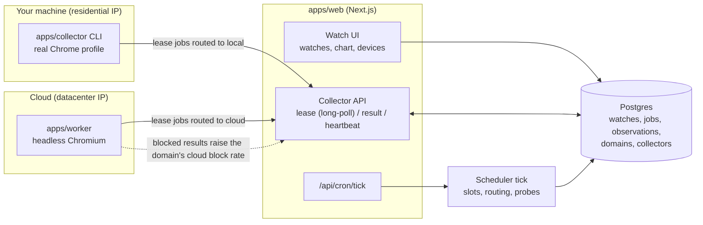
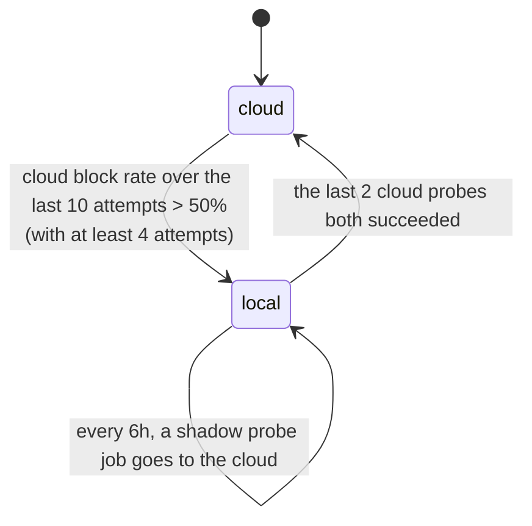
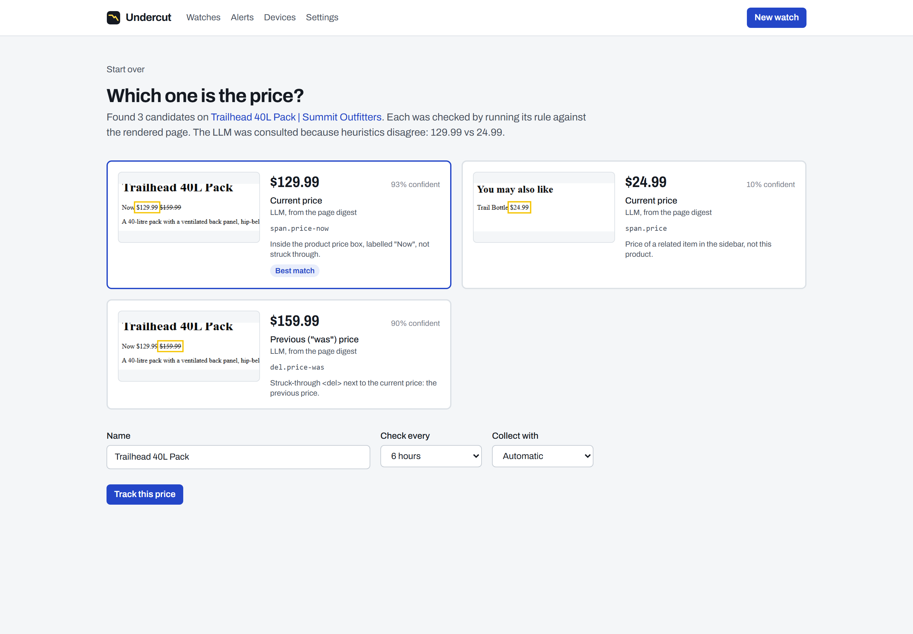
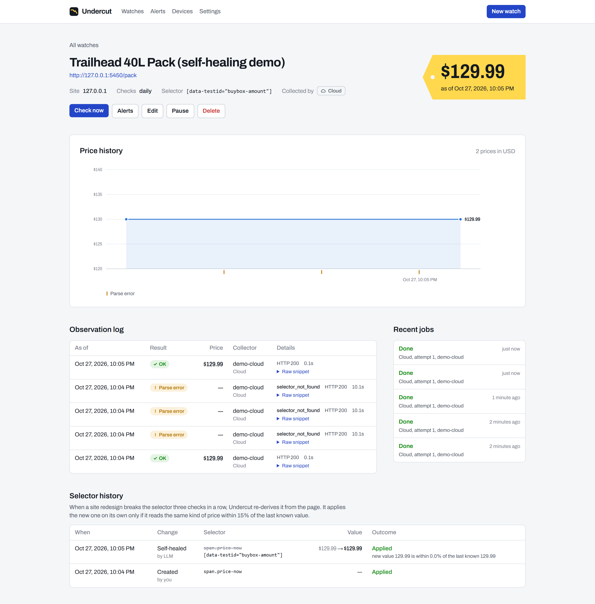
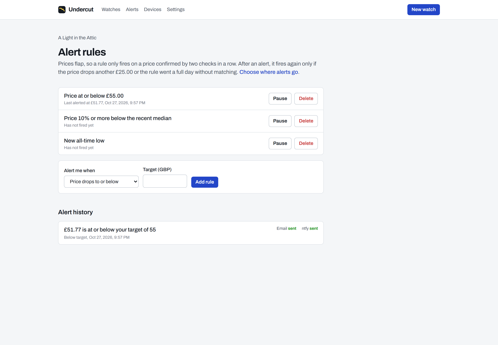

# Undercut

> Track the price of anything on any site, including the ones that block bots.


## Why this exists

Undercut started as a personal tracker for Cancun resort prices. The first version was a cloud job
that scraped Expedia and Booking.com every two hours, and it hit a wall: travel sites bot-block
datacenter IPs. From the cloud, every request came back as a 403, a "Just a moment..." challenge,
or a page shell where the price never rendered. The only thing that reliably got prices was a real
browser on a home internet connection.

The fix was a hybrid design, and Undercut turns it into a product:

- **Cloud workers** collect from sites that allow it. They are cheap, fast, and always on.
- A **local collector** (a small CLI on your own machine) runs a real Chromium on your residential
  IP for the sites that block the cloud. It pulls jobs from the server and pushes results back.
- The **scheduler learns the routing**. Each domain starts on the cloud. When the cloud's block
  rate on a domain crosses a threshold, the domain moves to local collectors, and the cloud is
  re-probed periodically in case the block lifts. Nobody has to configure which sites block bots.

## Status

| Milestone | Scope | State |
| --- | --- | --- |
| M1 | Data model, watch CRUD, cloud collector, price history | Done |
| M2 | Local collector, job leasing, device auth | Done |
| M3 | LLM-assisted selector extraction and self-healing | Done (LLM paths verified with recorded fixtures; no live LLM calls yet) |
| M4 | Alert engine and channels | Done: email, ntfy, Web Push |
| M5 | Learned routing dashboard | Routing is live; the Devices page shows per-domain block rates |
| M6 | Deploy, showcase migration, write-up | Not started |

## Architecture



Both collectors speak the same HTTP protocol (`packages/core/src/protocol.ts`, zod-validated on
both ends) and share one runtime (`packages/collector-runtime`). The only difference between a
cloud worker and a local collector is which jobs the server routes to it.

### Packages

| Path | What it is |
| --- | --- |
| `packages/core` | Pure domain logic: types, price parsing, block classification, routing policy, anti-flap helpers, extractor and alert interfaces, wire protocol. No I/O. |
| `packages/db` | SQL migrations and a typed query layer over postgres.js: watches, collectors, leasing, results, scheduler, read models. |
| `packages/collector-runtime` | What every collector runs: API client, Playwright capture, robots.txt cache, the lease loop. Also `analyzeUrl` for the paste-a-URL flow. |
| `packages/extraction` | Price discovery: DOM digest, structured-data and class heuristics, LLM candidates, ranking, and the self-healing decision. |
| `packages/llm` | Provider-neutral structured LLM calls: Anthropic, OpenRouter, `claude -p`, replay, and a disk cache. |
| `packages/notify` | Alert channels: SMTP email, ntfy, Web Push. |
| `apps/web` | Next.js App Router: the UI plus the collector API and the cron entry point. |
| `apps/worker` | Cloud collector process (headless Chromium, JSON logs). |
| `apps/collector` | Local collector CLI: `login`, `run`, `status`, `logout`. |

I chose plain SQL migrations plus a thin typed query layer over an ORM because the interesting
parts of this system are SQL: `FOR UPDATE SKIP LOCKED`, partial unique indexes, and data-modifying
CTEs. They read best as SQL.

## Job leasing

Jobs live in a Postgres table, not a separate queue. The table gives the leasing guarantees in a
few statements, and the database the app already needs is the only infrastructure.

**Lease.** One statement picks and claims a job (`packages/db/src/jobs.ts`, `leaseJob`):

```sql
WITH candidate AS (
  SELECT j.id FROM jobs j JOIN domains d ON d.domain = j.domain
  WHERE j.route = $kind AND j.attempts < j.max_attempts AND j.not_before <= now()
    AND (j.status = 'queued' OR (j.status = 'leased' AND j.lease_expires_at < now()))
    AND <domain politeness budget available>
  ORDER BY j.scheduled_for
  LIMIT 1
  FOR UPDATE OF j, d SKIP LOCKED
), leased AS (
  UPDATE jobs SET status = 'leased', lease_id = gen_random_uuid(), leased_by = $collector,
         lease_expires_at = now() + $ttl, attempts = attempts + 1
  FROM candidate WHERE jobs.id = candidate.id RETURNING jobs.*
), dispatched AS (
  UPDATE domains SET last_dispatched_at = now() FROM leased WHERE domains.domain = leased.domain
)
SELECT ... FROM leased JOIN watches ...;
```

- **`SKIP LOCKED`.** Competing collectors skip rows another transaction holds instead of waiting
  on them. Each job goes to exactly one collector, with no lock convoy.
- **Locking the domain row too** (`OF j, d`) serializes lease decisions per domain. Two collectors
  can't both see "one slot left" for the same site, so the per-domain concurrency limit holds
  under a race.
- **Expired leases are just leasable.** A crashed collector's job becomes available again when its
  lease runs out, with no reaper process. `attempts` counts tries, and the scheduler tick fails
  jobs that expire on their last attempt.
- **Fencing token.** Every lease gets a fresh `lease_id`, and a result is accepted only with the
  current one. A slow collector that comes back after its job was re-leased gets `409 lease_lost`
  and discards its result.
- **Leases are extended by heartbeat.** Collectors heartbeat every 30s with the lease ids they are
  still working on, so a slow page doesn't look like a dead collector.
- **Long-poll.** `POST /api/collector/lease` holds the request open for up to 30s until a job
  appears, so local collectors get work promptly without hammering the server.

**At-least-once collection, exactly-once recording.** A job may be attempted more than once. It is
recorded once at most:

| Failure | What prevents a duplicate |
| --- | --- |
| Scheduler tick retried or run twice | `idempotency_key = variant:slot` is `UNIQUE`; inserts use `ON CONFLICT DO NOTHING` |
| Collector offline, slots keep passing | Partial unique index: at most one outstanding job per variant, so no backlog |
| Collector dies mid-job | Lease expires; another collector re-leases it (`attempts` + 1) |
| Old lease holder reports late | `lease_id` fencing → `409` |
| HTTP response to a result is lost; collector retries | Job is already `done` with that lease → replay returns the original observation id |
| Any bug in the above | `observations.job_id` is `UNIQUE` |

Alert hooks (M4) run **after** the result transaction commits, so a failing notification can never
roll back or duplicate collected data.

## Learned routing policy

The policy is a pure function in `packages/core/src/routing/policy.ts`. The database applies it
inside the result transaction (`reevaluateRoute`), so every observation is fresh evidence.



- **Start on cloud.** It's the cheap path, and most sites allow it.
- **Move to local on sustained evidence.** The block rate is computed over a sliding window of the
  domain's last N cloud attempts, with a minimum sample count, so one bad request doesn't move a
  domain. Parse errors don't count as blocks: the page loaded, and the selector is the problem.
- **Re-probe the cloud.** While a domain is on local, the scheduler sends a *shadow* probe job to
  the cloud every 6 hours, in addition to the normal local job. Probing never costs the user a
  data point.
- **Hysteresis.** Entering local needs a sustained block rate. Leaving needs consecutive clean
  probes. The asymmetry stops a domain from flapping between routes on one lucky request. It's the
  same idea as the re-alert hysteresis below.
- **Overrides.** A watch can pin `cloud` or `local`. `auto` (the default) follows the domain.
- When a domain switches, queued (not yet leased) jobs are re-routed on the next tick.

All thresholds live in `DEFAULT_ROUTING`. The Devices page shows each domain's route, the reason it
switched, and recent and lifetime block rates per collector kind.

### What counts as "blocked"

`classifyCapture` (`packages/core/src/capture/classify.ts`) checks in this order:

1. A parsed price on a 2xx page is `ok`, even if a captcha widget is embedded somewhere on it.
2. HTTP 401/403/407/429 is `blocked`.
3. A challenge-page fingerprint is `blocked`, even when served with 200. Covered: Cloudflare,
   Akamai, PerimeterX, DataDome, Imperva, AWS WAF, reCAPTCHA, hCaptcha, and generic bot walls. Only
   challenge markers are listed, not vendors' always-on sensor scripts.
4. An empty price element, or a near-empty app shell, is `blocked`. Defenses often serve a 200
   page that never renders the price.
5. A full page where the selector matches nothing is a `parse_error`. That points at the selector
   (M3 self-heals these), not at the site.
6. A plain 5xx is transient: the job is retried with exponential backoff and nothing is recorded.

## Politeness

- **Per-domain concurrency** (`domains.max_concurrency`, default 1) and **minimum spacing**
  (`domains.min_interval_ms`, default 5s). Both are enforced in the lease statement, so they hold
  across any number of collectors.
- **robots.txt** is on by default. Collectors check it before fetching, as user agent
  `UndercutBot`, with a per-origin cache. A 4xx means no robots.txt (allow). A 5xx or an
  unreachable file means permission is unknown, so nothing is fetched and the job is retried with
  backoff. (The first live run hit exactly this: a transient timeout fetching robots.txt.) A
  disallowed job is marked `skipped`, not retried. Each domain can opt out (`domains.respect_robots`), and so can the local
  CLI (`--ignore-robots`).

## Device auth

Collectors authenticate with bearer tokens shaped like `uc_local_<43 chars>` (256 random bits).
Only a SHA-256 hash is stored (`collectors.token_hash`, unique-indexed), plus the last 4 characters
for display. A fast hash is the right choice here, unlike for passwords: a 256-bit random secret
can't be brute-forced, and a slow hash would only slow down every API call. The token is shown once
at creation. Revoking a device takes effect on its next request.

## Finding the price: heuristics first, LLM second



Adding a watch starts with **paste a URL**. The server renders the page in Playwright, finds
price candidates, validates each one, and shows them with a highlighted screenshot crop of the
element. The user confirms one by sight instead of by reading selectors.

1. **Heuristics run first.** They're free and deterministic (`packages/extraction/src/candidates.ts`):
   schema.org **JSON-LD** offers (`offers.price` / `lowPrice`, stored as a `json-ld` extraction
   rule that survives redesigns), **microdata** `[itemprop=price]`, **OpenGraph** product tags,
   and elements whose class or id says "price". Each gets a *meaning* (`current`, `was`,
   `per_unit`, `total`) from struck-through markup and nearby labels.
2. **The LLM is consulted only when heuristics are ambiguous.** That means no candidate, or
   current prices that disagree (say, the product's $129.99 and a related item's $24.99). On a
   page with structured data, or a single price-classed element, the LLM is never called. That
   saves cost and latency, and keeps the common case reproducible.
3. **The model sees a DOM digest, not the page.** `buildDigest` keeps only leaf elements whose
   text looks like a price. Each gets a unique CSS path (preferring stable ids and `data-testid`,
   skipping hashed class names), semantic hints from its ancestors (classes, `itemprop`,
   `<del>`/`<s>`), a nearby label ("Now", "Compare at", "per night"), and a strike-through
   flag. It drops scripts and styles and stays within a token budget (about 2,000 tokens by
   default). books.toscrape.com digests to 4 nodes.
4. **The model picks digest node ids; it doesn't write selectors.** The reply is
   zod-validated structured output: `{nodeId, meaning, confidence, rationale}`. Every answer
   maps to a CSS path we computed ourselves, and each pick is re-validated by running it against
   the full rendered HTML with the same extractor collectors use. A hallucinated id is dropped.

**LLM backends** (`packages/llm`, modeled on Witness's) sit behind one `Backend` interface:
`anthropic` (a forced tool call as structured output), `openrouter` (`json_schema` response
format), `claude-cli` (the local `claude -p`, with its own system prompt, tools, and MCP servers
disabled), and `replay` (fixtures keyed by call tag). Live backends are wrapped in a
content-addressed disk cache, so the same question is never paid for twice. A schema-invalid reply
gets one repair retry with the validation error shown to the model.

> **About the demos:** no live LLM call has been made in this repo. The LLM paths in tests and
> demos are served by **hand-authored replay fixtures** in the recorded format
> (`packages/extraction/test/fixtures/replay/*.json`, each marked `"model": "hand-authored"`).
> Their node ids match real digests. The heuristic path is fully live: on books.toscrape.com it
> finds `p.price_color` = £51.77 with no LLM involved (`docs/demo/extraction-books-toscrape.json`).

## Self-healing selectors



Collectors stay LLM-free. When a selector fails on a page that otherwise loaded (`parse_error`),
the collector attaches a **healing payload** to its result: the page digest and heuristic
candidates already validated against its live DOM. The server never has to refetch the page,
which matters for sites only a local collector can reach.

The scheduler's `healTick` (`packages/db/src/healing.ts`) finds watches whose last **3**
observations are all parse errors. It takes the newest healing payload and asks the LLM only if
the heuristics are ambiguous. Then `decideHeal` applies one rule:

- **Auto-apply** only if the best candidate has the **same meaning** as before and its value is
  **within 15%** of the last known price. A redesign shouldn't change the price, and a "was" price
  is often close to the current one, so meaning matters as much as value.
- Otherwise, **flag the watch for review**. The detail page shows the proposal with before/after
  values, and the user accepts or keeps the current selector. Undercut never silently starts
  tracking the wrong number.
- Every change is a `selector_history` row: old and new rule, old and new value, meaning, trigger
  (`created` / `edited` / `healed`), source (`user`, `json-ld`, …, `llm`), status, and reason.
  Each failure streak is handled once.

Recorded demo (`pnpm demo healing`, output in `docs/demo/self-healing.log`): a local shop page
reads $129.99 with `span.price-now`. Then it ships a redesign with every class renamed. Three
checks fail with `selector_not_found`, and the heal tick applies
`[data-testid="buybox-amount"]` (0.0% drift, LLM pick from the replayed fixture). The next real
check reads $129.99 again.

## Alerts



**Rules per watch:** price at or below a target; drop of at least X% from the trailing median
(last 20 observations); new all-time low. Rule evaluation is a pure function
(`packages/core/src/alerts/evaluate.ts`) with three layers of anti-flap:

1. **Debounce.** A rule only sees a *confirmed* level: two consecutive observations agreeing within
   0.5% (`confirmedPrice`). There's no bootstrap from a single reading, so a lone outlier never
   alerts.
2. **Re-alert hysteresis.** After an alert, the rule fires again only when the confirmed price is
   at least **$25 lower** (the original Cancun tracker's step rule, `shouldRealert`), or after a
   full day without qualifying.
3. **Quiet hours.** Deliveries that fall inside the window are **deferred** to its end, not
   dropped. The alert itself is recorded immediately.

The ATELIER sequence from the original tracker, against a $500 target, is a test case:
`606 → 499 → 517 → 491` fires **nothing**, because no two consecutive checks agree. Without the
debounce, it would have alerted on a $499 that vanished an hour later. Continuing with `489` then
alerts once (489 confirms 491). `464`, confirmed by `466`, re-alerts because it is exactly $25
lower.

**Recording is transactional and idempotent.** The alert engine is the `ObservationHook` that runs
after each observation commits. It runs in its own transaction, so alerting can never roll back
or duplicate collected data. Inside it:

- the variant's rule rows are locked `FOR UPDATE`, so concurrent observations see each other's
  hysteresis state;
- `UNIQUE (rule_id, level)` guarantees one alert per rule per price level, even under a race;
- the alert, its delivery rows, and the rule's state commit together.

A test evaluates the same observation 8 times concurrently from two connection pools and gets
exactly one alert and one set of deliveries.

**Channels** (`packages/notify`):

- **Email** via SMTP: Mailpit in dev, on SMTP port 5452 with its UI on 5451.
- **ntfy**: a local container on port 5453. The code refuses the public `ntfy.sh`, because topics
  there are world-readable.
- **Web Push**: VAPID keys generated locally; the service worker is `apps/web/public/sw.js`.

Each channel gets a `deliveries` row. A dispatcher, run by the scheduler or cron, claims due rows
with `SKIP LOCKED`, so it never double-sends. Failures back off exponentially (30s, 60s, … capped
at 1h) up to 5 attempts, and the Alerts page shows each delivery's status.

## Running locally

Requires Node 22+, pnpm 10+, and Docker.

```bash
pnpm install
pnpm exec playwright install chromium     # browser for collectors and tests
cp .env.example .env                      # one .env at the root serves every app

pnpm db:up                                # Postgres 17 on localhost:5447 (UNDERCUT_DB_PORT to change)
docker compose up -d mailpit ntfy         # alert channels: Mailpit UI http://localhost:5451, ntfy :5453
pnpm db:migrate

# A token for the cloud worker; put it in .env as UNDERCUT_COLLECTOR_TOKEN
pnpm admin create-collector --kind cloud --name cloud-worker-1

pnpm dev        # web on http://localhost:3210 + scheduler loop + cloud worker
```

Add a watch in the UI by pasting a URL. For example,
`https://books.toscrape.com/catalogue/a-light-in-the-attic_1000/index.html`. Undercut finds the
price and asks you to confirm it, and the first check is queued immediately. LLM assistance is
off by default (`UNDERCUT_LLM=none`); heuristics handle pages with structured data or a single
price element. For Web Push, put VAPID keys in `.env` (see `.env.example`).

**Demos** (no live LLM calls; see the note above):

```bash
pnpm demo books      # live extraction on books.toscrape.com, plus a replayed LLM pass
pnpm demo healing    # local shop page redesign -> 3 parse errors -> healed selector
pnpm demo alerts     # rules on a live watch; delivered to Mailpit and ntfy
```

**Local collector.** On the Devices page, create a local device token, then:

```bash
pnpm --filter @undercut/collector build
node apps/collector/dist/cli.js login --server http://localhost:3210 --token uc_local_...
node apps/collector/dist/cli.js run --headed      # uses your installed Chrome if available
```

**End-to-end smoke run** (live, against books.toscrape.com, a site built for scraping practice):

```bash
pnpm --filter @undercut/web build && pnpm --filter @undercut/web start   # in another terminal
pnpm --filter @undercut/worker build
pnpm smoke      # watches -> jobs -> cloud worker over HTTP -> observations -> screenshots
```

### In production

- The scheduler runs from a cron hitting `GET /api/cron/tick` with `Authorization: Bearer $CRON_SECRET`.
- Cloud workers run `node apps/worker/dist/main.js` anywhere Playwright runs (e.g. Fly.io).
- The local collector bundles to a single JS file next to Playwright. Packaging it as a single
  binary (Node SEA) is part of M6.

## Tests

```bash
pnpm -r test         # needs `pnpm db:up`; each db test file creates and drops its own database
pnpm -r typecheck
pnpm -r build
```

- `packages/core`: table tests for price parsing (symbols, ISO codes, locale separators, Indian
  grouping, "from $1,299/night", ranges, noise numbers), block classification, routing policy,
  and hysteresis.
- `packages/db`: against real Postgres. Two collectors on separate connection pools race 12
  contenders over 60 jobs, and each job is leased exactly once. Also covered: expired leases
  re-lease with fencing, result replay is a no-op, retries with backoff end in a failed job,
  per-domain concurrency and spacing hold under a race, racing scheduler ticks produce one job
  per slot, the backlog guard works, the full cloud → local → probe → cloud routing cycle, and
  hooks run post-commit and are failure-isolated.
- `packages/collector-runtime`: real headless Chromium against a local fixture server serving a
  normal product page, a client-rendered price, a WAF challenge (403 and 200), a 429, an app
  shell, a redesigned page, a 503, and robots.txt rules. Also tests the runner loop against an
  in-memory server.
- `apps/web`: the collector API route handlers, called directly: missing, unknown, and revoked
  tokens get 401; only hashes are stored at rest; bodies are validated (400); long-poll leasing is
  routed by collector kind; heartbeats extend leases; a fenced-out lease gets 409 and an unknown
  job gets 404.
- `apps/collector`: config round-trip and token-file permissions.
- `packages/extraction`: digest (leaf-only, unique paths, `data-testid` preference, token budget,
  scripts ignored), heuristics (JSON-LD + OpenGraph agreement, ambiguity detection), meaning
  inference, discovery with and without an LLM (replay fixtures), and the heal decision table.
- `packages/llm`: zod validation with one repair retry, the disk cache serving repeats, replay
  errors, and provider adapters with injected `fetch` (no network).
- `packages/db` (M3/M4): healing end to end (3 parse errors → LLM pick → applied, then the drift
  case → proposal → accepted, and no LLM → flagged); alert recording, concurrent-evaluation
  idempotency, quiet-hours deferral, retry with backoff to `failed`, and **real delivery** read
  back from Mailpit's API and ntfy's poll API.
- `packages/core` (M4): rule evaluation, including the ATELIER flapping sequence.
